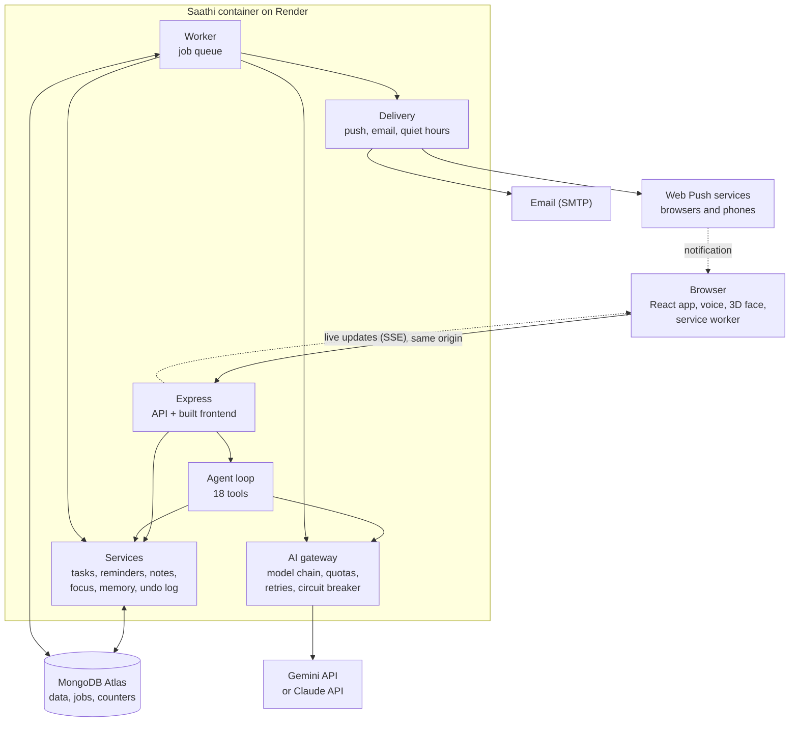

<div align="center">


<p>
  <a href="https://saathi-ksk8.onrender.com"></a>
  <a href="#-screenshots"></a>
</p>

<p>
  
  
  
  
  
  
</p>

**Your AI friend who gets things done.** Tell Saathi, by typing or speaking, *"kal subah 9 baje lab file submit karni hai, yaad dila dena"*, and it creates the task and the reminder in your account, reminds you on time in a friendly voice, and remembers what matters to you. It talks like a close friend, in your language.

**Live app:** [saathi-ksk8.onrender.com](https://saathi-ksk8.onrender.com) &nbsp;·&nbsp; **Demo video:** _link coming soon_

</div>

> [!NOTE]
> The free server sleeps after 15 minutes without visitors, so the first visit can take up to a minute to wake it.


## 📑 Contents

- [What is Saathi](#-what-is-saathi)
- [Try it in 60 seconds](#-try-it-in-60-seconds)
- [Features](#-features)
- [Screenshots](#-screenshots)
- [Architecture](#-architecture)
- [Engineering highlights](#-engineering-highlights)
- [Tech stack](#-tech-stack)
- [Local setup](#-local-setup)
- [Environment variables](#-environment-variables)
- [API](#-api)
- [Project structure](#-project-structure)
- [Deployment](#-deployment)
- [Roadmap](#-roadmap)
- [AI usage](#-ai-usage)
- [Credits and author](#-credits-and-author)

## 💡 What is Saathi

**The problem.** Students juggle assignments, lab submissions, exams and small personal errands across chat messages, notebooks and memory. Normal to-do apps make you stop, open a form, pick a date and type everything in, so things never get written down. Chatbots can talk about your tasks, but they cannot keep, change or remind you of them.

**Who it is for.** College students in India (and anyone with a busy schedule) who would rather say what they need in plain language, in Hinglish, English, Hindi or their own language, than fill in forms.

**The solution.** Saathi is a chat and voice assistant connected to your own data. The AI model (Google Gemini by default, Claude as an option) reads your request and decides which actions to take: create a task, set a reminder, make a study plan, save a note, remember a fact. The server validates every action with the same rules as the normal screens, carries it out against your account, and shows it as a receipt with an Undo button. A background worker fires reminders on time, and Saathi messages you first when something is overdue.

## ⚡ Try it in 60 seconds

1. Open **[saathi-ksk8.onrender.com](https://saathi-ksk8.onrender.com)** (give it up to a minute if the free server is asleep).
2. Click **Account banao** and sign up with any name, email and password.
3. Tap anywhere once and allow notifications when the browser asks.
4. In the chat, type or say (mic button): *"2 minute baad paani peene ka reminder lagao"*. Saathi creates it and shows a receipt with Undo.
5. Wait two minutes: the reminder arrives with Saathi's own line, as a card in the app and as a notification on your device, with "Ho gaya ✅" and "10 min baad 😴".

Then try *"25 ko DBMS exam hai, plan bana do"* or the **Timer** button at the top.

## ✨ Features

### 🤖 AI agent: an agent, not a chatbot
- Chat with tool calling: 18 tools (tasks, reminders, notes, study plans, plan my day, focus timer, memory, undo) run through the same validated services as the screens
- A receipt with Undo for every change Saathi makes; deleting needs a Confirm tap
- Long-term memory (classes, hard subjects, routines) that you can see and edit in Settings
- Saathi texts first: a nudge about overdue tasks (never at night, at most once per task per day) and an evening recap with "move leftovers to tomorrow"
- **Languages:** Saathi replies in the language you write or speak, with the same friendly personality in every language. Preferred language in Settings: Hinglish, English, Hindi, Marwari (beta), Tamil, Bengali
- **Voice:** mic button in the chat box: speak, your words appear as you talk and are sent when you stop (Web Speech API, Hindi/Hinglish and English). Speaker button (off by default): Saathi's replies are read aloud in the reply's language; the face listens, thinks and speaks

### 📚 Productivity
- Tasks with due dates, priority, tags and deadline countdowns; habits (daily or weekly) with streaks; quick add from one sentence
- Reminders that fire exactly once, with snooze; a friendly line written by Saathi at fire time (plain text if the AI is down, never late)
- Study plans: "25 ko DBMS exam hai, plan bana do" spreads the topics over the days with a reminder for each session; changing the plan replaces it instead of adding a second one
- Plan my day: Saathi arranges today's tasks into time slots around your classes, shown as a timeline on the Today panel
- Today panel, a 14-day progress chart, an activity timeline with Undo, notes with search and pins
- Live updates in every open tab (Server-Sent Events)

**⏱️ Focus timer**
- Any length on any task or activity (1 minute to 12 hours: hours and minutes plus quick picks), or from chat: "ye kaam 2 ghante 30 minute mein khatam karna hai" and Saathi starts it
- Small and sticky on every screen; the big view has a golden ring that empties with the time, big numbers and Saathi's face, whose mood follows the clock (happy at the start, a little tense near the end)
- Pause, Resume, +5 min, Khatam (also completes the task), Cancel; the end time is kept on the server, so it survives a refresh or a closed tab
- When the time is up: a soft chime, a notification on every device asking "Ho gaya? ✅ / 10 min aur? ⏳"; when the work is done: a short golden star-burst celebration with Saathi's line and the time taken (no motion with reduced motion)
- Focus minutes on the Today panel, the progress chart and the activity timeline

### 🔔 Notifications everywhere, in Saathi's voice
- Push notifications on phones and computers (Chrome, Edge, Android, iPhone after "Add to Home Screen"), even with the app closed: Web Push with a service worker and VAPID keys; every device of a user is registered and expired ones are removed automatically
- Always on, no setting: the browser asks on your first tap after login. If you say no (or on an iPhone not added to the Home Screen), notifications still reach you in the app, and the important ones (reminders, tasks due, the morning plan) by email
- For everything that matters: reminders, a task due in an hour and due now, overdue nudges, the morning "Aaj ka din", the evening recap, exam countdowns (3 days, 1 day, today), study sessions, the focus timer, streak and weekly milestones, and what Saathi did from the chat if you closed the app
- Every message written fresh by the AI in your language (a plain line if the AI is down, never late), with its own emoji, Saathi's icon, a space photo on Android/Chrome, and buttons: "Ho gaya ✅", "10 min baad 😴", "Kholo" (opens the right screen)
- In the app: big glass cards with Saathi's face, the kind's colour and photo, big buttons; they stack, Esc closes the newest, reminders stay until you act, the others shrink after a few seconds
- No spam: quiet hours 11 PM to 7 AM (only reminders and timers ring), several tasks at once become one notification, at most 2 nudges a day, emails only for the important kinds and at most 10 a day
- Installable app (PWA) with its own icon

### 🎨 Design
- **Saathi's face:** a glowing golden 3D orb (React Three Fiber, custom shader) that breathes, blinks, follows your cursor and changes expression with each reply; a 2D SVG version is used without WebGL or with reduced motion
- **Saathi Orbit landing page:** Saathi's features orbit its glowing core as dotted planets (Three.js), followed by a scroll story with a 3D folding feature panel and smooth scrolling
- **Real space backgrounds:** every screen sits on a photo from ESA/Hubble, NASA, Chandra or Pexels (Reminders on NASA's black hole visualization), with a dark veil and glass panels so text stays readable
- Loading skeletons, empty states with a next step, and error states with a retry on every screen; works on phones with a bottom tab bar

## 📸 Screenshots

| | |
|---|---|
|  |  |
| Landing page: Saathi's features orbit its glowing core (Three.js) | Mic in the chat box: the face turns violet and listens |
|  |  |
| Tasks grouped by when they are due | Completed tasks and the 14-day progress chart |
|  |  |
| Reminders with snooze and cancel, over NASA's black hole visualization | Every change, yours or Saathi's, with Undo |
|  |  |
| Notes | Settings: language, profile and what Saathi remembers |
|  |  |
| Focus timer: any length, quick picks | The golden ring empties with the time; Saathi's face follows the clock |
|  |  |
| Done: golden stars, Saathi's line and the time taken | In-app notification: a reminder fired, with Saathi's own line and the buttons "Ho gaya ✅", "10 min baad 😴", "Kholo" |

<p align="center">
  <br>
  <sub>On a phone: the same screens with a bottom tab bar</sub>
</p>

The space photos behind the screens come from ESA/Hubble, NASA, Chandra, ESA Herschel and Pexels; every photo and its credit is listed in **[CREDITS.md](CREDITS.md)** (and in the app under Settings).

## 🏗️ Architecture



**How one request flows:** you say "kal 9 baje lab file yaad dila dena" → the agent sends your message, your memories and today's agenda to the AI → the AI asks for `create_task` and `set_reminder` → each tool call is validated and run through the same service as the Tasks screen (so it is logged and undoable) → the results go back to the AI, which writes a short reply → the chat shows the reply and a receipt per change. At 9 AM the worker claims the reminder job (atomically, so it fires once), asks Saathi for a friendly line, and pushes it to your open tabs, your devices (Web Push) and, if no device can be reached and the app is closed, your email.

One Docker image runs as `web`, `worker` or `all` (`PROCESS_ROLE`). Everything shared between instances (sessions, jobs, rate limits) lives in MongoDB or in the signed cookie, never in one instance's memory. Details and load tests: **[docs/SCALING.md](docs/SCALING.md)**.

## 🛠️ Engineering highlights

**Measured, then fixed.** Load-tested with `autocannon` on a 2-core machine (the load generator shared the same cores, so absolute numbers are pessimistic; the before/after comparison is what matters). From [docs/SCALING.md](docs/SCALING.md):

| Scenario | Before | After |
|---|---|---|
| Health check, no load | 5,155 req/s, p99 33 ms | 7,078 req/s, p99 23 ms |
| `GET /api/auth/me` (auth + user lookup) | 737 req/s, p99 139 ms | 1,628 req/s, p99 67 ms |
| **Health check while logins run** | **21 req/s, p99 3.35 s** | **5,135 req/s, p99 9 ms** |

The big fix: password hashing moved from pure-JavaScript bcrypt (which froze the event loop) to Node's built-in `scrypt` on the thread pool, plus a 30-second user cache and a right-sized connection pool.

**Security**
- Secure accounts: scrypt password hashing, JWT in an httpOnly cookie, brute-force limits per IP and per account, a single-use emailed reset link that logs out every session, and "Continue with Google" (Google's signed ID token is checked on the server; an existing account with the same verified email is joined, not duplicated)
- Every query is scoped to the logged-in user; other users' data is never visible (404, not 403)
- No secrets in Git: everything comes from environment variables, validated at startup

**Reliability**
- Background work in a MongoDB job queue: atomic claim, lock heartbeat, retries with backoff, dead-lettering, dedupe keys, so a reminder fires exactly once even with several instances
- AI gateway: a chain of models with per-model limits, per-user quotas, timeouts, retries honouring `Retry-After`, and a circuit breaker; when the AI is down, tasks, notes and reminders keep working
- Error handling everywhere: invalid input gets field-level messages, failed AI calls fall back to the next model or a friendly message, duplicates are caught (`Idempotency-Key`, similar-task check)
- Ready to scale: stateless instances, a MongoDB job queue, shared quotas, health checks and graceful shutdown ([docs/SCALING.md](docs/SCALING.md))

**Quality**
- 148 automated tests (unit and integration) with `node:test` and supertest, against a real MongoDB; the AI is replaced by a fake provider, so tests are free and repeatable

## 🧰 Tech stack

| Layer | Choice | Why |
|---|---|---|
| Frontend | React 19, Vite, Tailwind CSS, Motion, React Three Fiber | Fast builds; one design system; motion only where something changes; one 3D element (Saathi's face) with a 2D fallback |
| Backend | Node.js, Express 5 | Async errors are handled natively; small and well understood |
| Database | MongoDB Atlas with Mongoose | Tasks, notes and conversations are document-shaped; free hosted tier |
| Auth | scrypt (Node built-in) + JWT in an httpOnly cookie | Passwords are never stored in plain text; hashing runs off the event loop; tokens are unreadable from page JavaScript |
| AI | Google Gemini (function calling) by default, Claude (tool use) as an option | Gemini's free tier suits a student project. One provider interface (`server/src/ai/provider.js`): `AI_PROVIDER` switches without touching the agent code |
| Voice | Web Speech API (SpeechRecognition, speechSynthesis) | Built into Edge and Chrome, free, supports Indian languages. The browser turns speech into text (Edge and Chrome use their own speech service for this); Saathi's server only receives the text |
| Notifications | Web Push (service worker, VAPID, `web-push`), nodemailer | Works on desktop and phones with the app closed, no paid service; email as the fallback |
| Background jobs | Job queue in MongoDB | Reminders run exactly once, even with many instances; no extra service to pay for |
| Validation | zod | One schema validates input and produces field-level error messages |
| Logging | pino (JSON) | Structured logs with request ids |
| Deployment | Docker on Render | One image serves the API and the built frontend; runs on any container platform |

## 🚀 Local setup

Requirements: Node.js 20.19 or newer, a free MongoDB Atlas cluster, a free Gemini API key (aistudio.google.com).

```bash
# 1. Backend
cd server
npm install
copy .env.example .env      # on macOS/Linux: cp .env.example .env
# open server/.env and fill in MONGODB_URI, JWT_SECRET and GEMINI_API_KEY
npm run dev                 # http://localhost:4000

# 2. Frontend (second terminal)
cd client
npm install
npm run dev                 # http://localhost:5173 (calls to /api go to port 4000)
```

Check the backend: http://localhost:4000/api/health/ready should show `{"status":"ok","database":"up"}`. For voice, use Microsoft Edge (best Indian voices) or Chrome.

**Production build locally:** `cd client && npm run build`, then in `server` run `$env:NODE_ENV='production'; node src/index.js` (PowerShell) or `NODE_ENV=production node src/index.js` (macOS/Linux): the server also serves the built app at http://localhost:4000.

**With Docker (optional):**

```bash
docker build -t saathi .
docker run -p 4000:4000 --env-file server/.env saathi
```

### Tests

The tests need a separate database because they wipe it. Add `MONGODB_URI_TEST` to `server/.env` (same as `MONGODB_URI` but ending in `/saathi_test`), then `cd server && npm test`. The tests never call a real AI (a fake provider stands in).

To try Saathi with the real AI from the terminal (server running): `npm run live:chat -- "kal subah 9 baje lab file submit karni hai, yaad dila dena"`. It uses a throwaway account and deletes it afterwards; `npm run live:cleanup` removes leftovers.

## 🔐 Environment variables

Set in `server/.env` locally, or in the Render dashboard.

| Variable | Required | Description |
|---|---|---|
| `MONGODB_URI` | yes | MongoDB Atlas connection string |
| `JWT_SECRET` | yes | Random string of at least 32 characters used to sign login tokens |
| `GEMINI_API_KEY` | for chat | Gemini API key from aistudio.google.com (free tier) |
| `AI_PROVIDER` | no | `gemini` (default) or `anthropic` |
| `GEMINI_MODELS` | no | Model chain, tried in order (default `gemini-3.5-flash-lite,gemini-3.1-flash-lite,gemini-3.8-flash`). When one reaches its limit, the next one answers |
| `AI_MODEL_LIMITS` | no | Requests per model for the whole app, `model=perMinute/perDay`, just below the free-tier limits. When every model is full, Saathi says so kindly and everything except chat keeps working |
| `NODE_ENV` | no | `production` on the server (secure cookies, serves the built frontend) |
| `PROCESS_ROLE` | no | `all` (default: API + worker in one process), `web` or `worker` |
| `CLIENT_ORIGIN` | no | The app's address, e.g. `https://saathi.onrender.com` (default `http://localhost:5173`) |
| `APP_URL` | no | Address used in email links (default `CLIENT_ORIGIN`) |
| `VAPID_PUBLIC_KEY`, `VAPID_PRIVATE_KEY`, `VAPID_SUBJECT` | for push | Web Push key pair (`npx web-push generate-vapid-keys`) and a contact (`mailto:...` or your https address). Without them notifications still arrive in the app and by email |
| `SMTP_HOST`, `SMTP_PORT`, `SMTP_SECURE`, `SMTP_USER`, `SMTP_PASS`, `MAIL_FROM` | for email | SMTP for password reset links and the email copy of important notifications (a Gmail App Password works). Without `SMTP_HOST` the email is written to the server log |
| `BREVO_API_KEY` | for email on Render's free plan | Sends the same emails through Brevo's HTTPS API (free, 300 a day) instead of SMTP, because Render's free plan blocks the SMTP ports. `MAIL_FROM` must be a sender verified in Brevo |
| `GOOGLE_CLIENT_ID` | optional | OAuth Web Client ID for "Continue with Google" (public, not a secret). Without it the Google button is hidden |
| `ANTHROPIC_API_KEY`, `ANTHROPIC_MODEL`, `ANTHROPIC_FALLBACK_MODEL` | for Claude | Only with `AI_PROVIDER=anthropic` |
| `JWT_EXPIRES_IN`, `PORT`, `MONGO_MAX_POOL`, `LOG_LEVEL` | no | Login lifetime (7d), port (4000), DB connections per instance (10), log level (info) |
| `AI_REQUEST_TIMEOUT_MS`, `AI_TOTAL_TIMEOUT_MS`, `AI_USER_PER_MINUTE`, `AI_USER_PER_DAY`, `AI_MAX_CONCURRENCY`, `AI_MAX_QUEUE` | no | AI timeouts (20 s / 28 s), per-user limits (20 per minute, 300 per day) and per-instance limits |
| `MONGODB_URI_TEST` | for tests | Separate database for the test suite |

## 📡 API

**In short:** auth (`/api/auth`), tasks (`/api/tasks`), notes (`/api/notes`), reminders (`/api/reminders`), my day, progress, notifications and activity (`/api/me`), push devices and notification buttons (`/api/push`), the focus timer (`/api/focus`), and Saathi itself (`/api/agent`). All JSON; chat and live updates stream as Server-Sent Events.

<details>
<summary><b>Full endpoint list</b> (click to open)</summary>

| Method | Path | Auth | Description |
|---|---|---|---|
| GET | `/api/health/live` | no | Process is alive (used to restart hung containers) |
| GET | `/api/health/ready` | no | Ready for traffic: database reachable and not shutting down |
| POST | `/api/auth/signup` | no | Create an account `{ name, email, password, timezone? }` |
| POST | `/api/auth/login` | no | Log in `{ email, password }` |
| GET | `/api/auth/config` | no | `{ googleClientId }` for the login page (null hides the Google button) |
| POST | `/api/auth/google` | no | `{ credential }`: Google ID token. Logs in, joins an account with the same verified email, or creates one (201) |
| POST | `/api/auth/logout` | no | Clear the session cookie |
| POST | `/api/auth/forgot-password` | no | `{ email }`: emails a reset link (30 minutes, single use, only a hash stored). Always the same answer, so it never reveals which emails have accounts |
| POST | `/api/auth/reset-password/check` | no | `{ token }`: is this link still usable? |
| POST | `/api/auth/reset-password` | no | `{ token, password }`: sets the new password and logs out every session |
| GET | `/api/auth/me` | yes | Current user |
| PATCH | `/api/auth/me` | yes | Update `{ name?, timezone?, language? }` |
| GET | `/api/tasks` | yes | List: `status` (open/done/all), `due` (today/overdue/upcoming/none), `kind`, `q`, `tag`, `sort` (due/created/priority/completed), `page`, `limit` |
| POST | `/api/tasks` | yes | Create `{ title, notes?, kind?, priority?, dueAt?, tags?, repeat? }`. `repeat: { every: 'day' }` or `{ every: 'week', days: ['mon','thu'] }` makes it a habit |
| POST | `/api/tasks/quick-parse` | yes | Quick add: `{ text }` becomes a task draft to preview; nothing is saved. Without the AI the sentence becomes the title |
| GET | `/api/tasks/habits` | yes | The current occurrence of each habit, with its streak |
| GET / PATCH / DELETE | `/api/tasks/:id` | yes | Read, edit, delete (undoable) |
| POST | `/api/tasks/:id/complete`, `/reopen` | yes | Mark done / open again. Completing a habit creates its next occurrence |
| GET / POST | `/api/notes` | yes | List (`q`, `tag`, `pinned`) / create `{ body, title?, tags?, pinned? }` |
| GET / PATCH / DELETE | `/api/notes/:id` | yes | Read, edit, delete |
| GET / POST | `/api/reminders` | yes | List (`status`) / create `{ text, remindAt, taskId? }` |
| PATCH / DELETE | `/api/reminders/:id` | yes | Change text or time / cancel |
| POST | `/api/reminders/:id/snooze` | yes | `{ minutes }` or `{ until }` |
| GET | `/api/me/events` | yes | Live updates (Server-Sent Events): `ready`, `notification`, `changed` |
| GET | `/api/me/today` | yes | Today panel data |
| POST | `/api/me/leftovers/move-to-tomorrow` | yes | The recap's button: today's unfinished tasks move to tomorrow (each move undoable) |
| GET | `/api/me/progress` | yes | Completions per day (14 days), this week vs last, streak |
| GET | `/api/me/hints?q=` | yes | Open tasks related to what the user is typing |
| GET | `/api/me/notifications` | yes | Notifications (`unread=true`), with unread count |
| GET | `/api/push/key` | yes | The public VAPID key for subscribing this device |
| POST | `/api/push/subscribe`, `/unsubscribe` | yes | Register this device for push `{ endpoint, keys: { p256dh, auth }, device? }` / forget it `{ endpoint }` |
| POST | `/api/push/action` | yes | A notification button `{ notificationId, action: done / snooze / more / open }` |
| GET | `/api/focus/current` | yes | The running focus timer (or null) |
| POST | `/api/focus` | yes | Start a timer `{ minutes (1 to 720), taskId?, label? }`; one at a time (409 otherwise) |
| POST | `/api/focus/:id/pause`, `/resume`, `/extend`, `/finish`, `/cancel` | yes | Control the timer; `extend { minutes }`, `finish { done }` also completes its task and returns Saathi's line |
| POST | `/api/me/notifications/:id/read`, `/read-all` | yes | Mark read |
| GET | `/api/me/activity` | yes | Timeline of changes, each with `canUndo` |
| POST | `/api/me/activity/:id/undo` | yes | Undo one change |
| POST | `/api/agent/chat` | yes | Talk to Saathi `{ message, conversationId?, voice? }` (`voice: true` asks for a short reply to read aloud). Streams Server-Sent Events: `start`, `expression`, `text`, `reset`, `tool`, `receipt`, `confirm`, `error`, `done` |
| GET | `/api/agent/greeting` | yes | A freshly generated greeting (cached for 5 minutes) |
| GET | `/api/agent/conversations` | yes | The user's conversations |
| GET | `/api/agent/conversations/:id/messages` | yes | Messages, newest page (`before`, `limit`) |
| POST | `/api/agent/actions/:id/confirm`, `/cancel` | yes | Confirm or cancel an action Saathi proposed (deleting a task) |
| GET / POST | `/api/agent/memories` | yes | What Saathi remembers / add a memory `{ text, kind? }` |
| DELETE | `/api/agent/memories/:id` | yes | Forget a memory |

</details>

Dates are ISO 8601 with a timezone (`2026-10-18T09:00:00+05:30`); dates without one are rejected because "9 AM" is ambiguous. Create endpoints accept an optional `Idempotency-Key` header: the same key twice returns the first response instead of creating a duplicate. Every error has the same shape: `{ "error": { "code": "...", "message": "...", "details": [...] } }`. Every response has an `X-Request-Id` header that matches the server log line; 429 and 503 responses include `Retry-After`.

## 📁 Project structure

```
client/                React app (Vite)
  public/              service worker (sw.js), PWA manifest and icons, space photos (bg/)
  src/app/             app shell: navigation, live updates, Undo bar, focus timer state
  src/screens/         Home (chat + Today), Tasks, Reminders, Notes, Activity, Settings, auth
  src/components/      chat parts, faces (2D and 3D), progress chart, backgrounds, focus timer, notification cards
  src/landing/         landing page and the Saathi Orbit scene
  src/lib/             API client, speech (voice), push, languages, photos
server/
  src/config/          environment validation (refuses to start with bad config)
  src/models/          Mongoose schemas
  src/routes/          HTTP endpoints (thin)
  src/services/        business logic, kept separate from HTTP
  src/ai/              agent tools, prompt, Gemini/Claude providers, gateway
  src/jobs/            MongoDB job queue, worker, reminder and proactive jobs
  src/middleware/      auth, validation, errors, idempotency, overload protection
  tests/               unit and integration tests (node:test + supertest)
docs/                  scaling notes, screenshots, banner
Dockerfile, render.yaml
```

## ☁️ Deployment

Render, one web service from `render.yaml` (New → Blueprint). The Docker image builds the React app and the server; Express serves both from the same address, so the login cookie needs no CORS. Free plan: `PROCESS_ROLE=all` (API and reminder worker in one process), health check `/api/health/ready`. Secrets (`MONGODB_URI`, `GEMINI_API_KEY`, VAPID keys, SMTP) are entered in the Render dashboard, never committed. MongoDB Atlas must allow Render's addresses (Network Access `0.0.0.0/0`; the database user's password protects it).

The free plan sleeps after 15 minutes without visits; reminders that fall due while it sleeps fire as soon as it wakes. A free uptime monitor calling `/api/health/live` every few minutes keeps it awake. Scaling beyond one instance: [docs/SCALING.md](docs/SCALING.md).

**Live link:** https://saathi-ksk8.onrender.com

## 🗺️ Roadmap

- 🌐 More languages for the app and voice: Marathi, Gujarati, Punjabi, Telugu, Kannada, Malayalam, Odia, Urdu, Bhojpuri and more, and every screen fully translated (today the navigation, titles, chat and settings are translated; the rest is in Hinglish)
- 🙋 "Apni bhasha maango": a button in Settings to ask for a missing language, so the most requested ones come first
- ✅ Marwari out of beta, checked with native speakers
- 🔑 Facebook and Instagram sign-in, next to email, password and Google
- 📅 Google Calendar sync (classes and exams in, Saathi's reminders out)
- 💬 Saathi on WhatsApp and Telegram
- 📄 Upload a syllabus or PDF and turn it into a study plan
- 🔎 Web search for explanations and quick facts
- 👥 Shared tasks and study groups with friends

## 🤝 AI usage

This project was built with help from Claude (Anthropic) for code generation, debugging and documentation, as allowed by the project guidelines. Every workflow is tested (148 automated tests plus live checks with the real AI), and the code is understood and maintained by the author. Inside the app, the AI (Gemini) only proposes actions; the server validates and executes them, and every change can be undone.

## 🙏 Credits and author

Background photos: ESA/Hubble, NASA, Chandra X-ray Observatory, ESA Herschel and photographers on Pexels; full list with sources and licences in [CREDITS.md](CREDITS.md). Fonts: Baloo 2 and Mukta (Google Fonts). Icons: Lucide.

Using NASA and ESA images does not mean they endorse this project.

**Author:** Himanshu ([@harisharma81182-hash](https://github.com/harisharma81182-hash)), End-Term Software Project, 2026.
